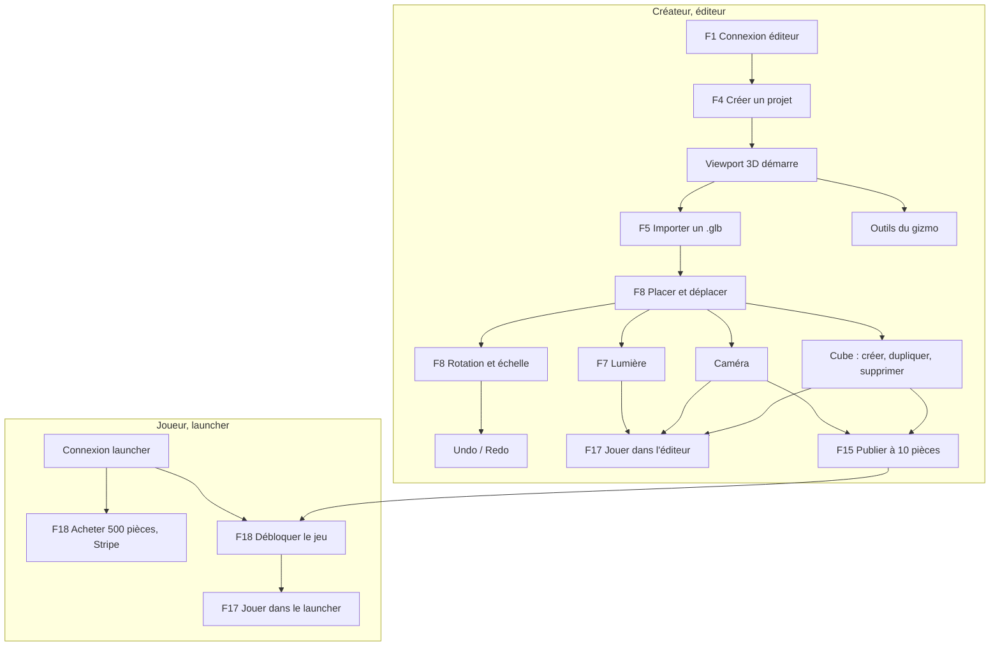
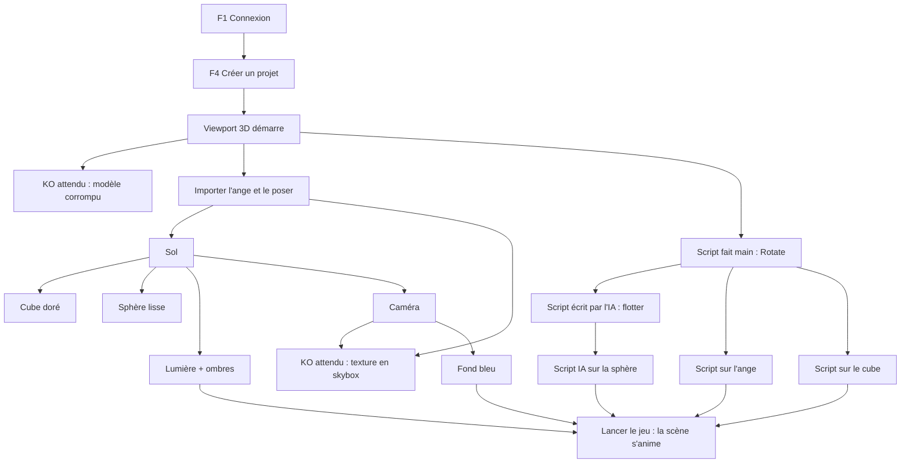

# Scénarios de test d'Horizon en production

horizon-analyzer rejoue trois scénarios contre la prod :

- un **smoke** de 2 secondes qui ne touche à rien ;
- un **parcours critique** de 17 features qui suit un créateur puis un joueur, du premier modèle
  3D importé jusqu'au jeu acheté et lancé dans le launcher ;
- un **scénario moteur** de 18 features qui construit une scène (modèle importé, ombres, reflets,
  fond coloré, un script fait main et un script écrit par l'assistant IA), vérifie qu'elle s'anime
  en jeu, et deux cas qui ne fonctionnent pas dans Horizon (modèle corrompu, texture en skybox),
  qui sortent KO exprès.

Chacun nettoie tout ce qu'il crée.

| Fichier | Features | Durée | Écrit en prod | Où le lancer |
| --- | --- | --- | --- | --- |
| [`scenarios/smoke.yaml`](../scenarios/smoke.yaml) | 3 | ~2 s | Non | Partout, en headless (CI toutes les heures) |
| [`scenarios/critical.yaml`](../scenarios/critical.yaml) | 17 | ~35 s | Oui, puis nettoyé | Machine avec GPU, navigateur visible |
| [`scenarios/engine.yaml`](../scenarios/engine.yaml) | 18 | ~2 min | Un projet, supprimé en fin de run | Machine avec GPU, navigateur visible |

Chaque feature des fichiers YAML est précédée d'un commentaire qui dit ce qu'elle teste, comment
c'est vérifié et ce qu'elle écrit en prod. Cette page en donne la vue d'ensemble. Pour écrire ou
modifier un scénario : [ecrire-un-scenario.md](ecrire-un-scenario.md).

## Lancer

### Tout lancer (Windows)

```powershell
cd horizon-analyzer
copy .env.example .env        # une seule fois : renseigner HORIZON_EMAIL et HORIZON_PASSWORD
.\run-all.ps1                 # installe au premier lancement, puis smoke + parcours critique
```

`run-all.ps1` crée le venv et installe Chromium s'il ne les trouve pas (`-Setup` pour forcer),
lance le smoke en headless puis le parcours critique dans une fenêtre visible, et affiche le
résultat de chacun. `-SlowMo 300` ralentit chaque action pour suivre le test à l'œil.

Si PowerShell refuse le script (« l'exécution de scripts est désactivée ») :

```powershell
powershell -ExecutionPolicy Bypass -File .\run-all.ps1
```

### Lancer une suite, une feature, un tag

Après `.venv\Scripts\activate` (ou en préfixant par `.venv\Scripts\`) :

```powershell
horizon-analyzer run scenarios/critical.yaml                      # tout le parcours
horizon-analyzer run scenarios/smoke.yaml --headless              # le smoke
horizon-analyzer run scenarios/critical.yaml --only F18-buy-coins # une feature (+ ce dont elle dépend)
horizon-analyzer run scenarios/critical.yaml --tags payment       # un tag (+ dépendances)
horizon-analyzer run scenarios/critical.yaml --safe-only          # sans rien écrire en prod
horizon-analyzer validate scenarios/critical.yaml                 # vérifier le fichier, sans navigateur
```

| Option | Effet |
| --- | --- |
| `--only <id>` | Ne lance que cette feature et celles dont elle dépend (ex. `--only F18-buy-coins` lance aussi `LAUNCHER-login`) |
| `--tags <tag>` | Ne lance que les features portant ce tag : `critical`, `smoke`, `3d`, `transform`, `play`, `payment`, `launcher`, `auth`, `editor`, `assets`, `publish`, `lighting` |
| `--safe-only` | Retire les features marquées `mutating` ; celles qui en dépendent sont sautées |
| `--headless` | Sans fenêtre. Le viewport 3D y plante (WebGPU logiciel) : à réserver au smoke |
| `--slow-mo 500` | Pause de 500 ms entre chaque action |
| `--no-trace` | Pas de `trace.zip` (plus rapide) |
| `--no-cache` | Retélécharge le code et le wasm d'Horizon à chaque run (par défaut, ils sont gardés dans `runs/.cache/`) |
| `--webhook <url>` | Prévient Discord ou Slack en cas d'échec (défaut : `HORIZON_WEBHOOK_URL`) |

Linux ou macOS : `source .venv/bin/activate`, puis les mêmes commandes `horizon-analyzer`.

## Le parcours critique

Les features tournent dans l'ordre du fichier, sur une seule page : la connexion du début sert à
toute la suite. La page n'est jamais rechargée : tout le travail dans l'éditeur se fait sur la
même scène, sans refresh. De courtes pauses (2 à 3 s) laissent voir la scène chargée, le modèle
posé, la scène complète et le jeu lancé. Une flèche signifie « dépend de » : si une feature échoue, celles qui en
découlent sont sautées, les autres continuent.



### Côté créateur (éditeur)

| Feature | Ce qui est testé | Comment c'est vérifié | Écrit en prod |
| --- | --- | --- | --- |
| `F1-login` | Connexion à l'éditeur | POST /login 2xx, accueil « Welcome back » | Non |
| `F4-create-project` | Créer un projet | POST /room 201, URL /editor?id=… | Projet `e2e-<run id>`, supprimé en fin de run |
| `EDITOR-viewport` | Le moteur Bevy démarre | Log « backend: BrowserWebGpu », aucun panic, le canvas dessine la grille | Non |
| `F5-import-mesh` | Importer un modèle 3D | Upload de `e2e-cube.glb`, lookup catalogue 2xx, asset visible dans My Assets | Asset privé au projet |
| `F8-place-and-move` | Placer et déplacer | Glisser sur le viewport crée « Object » ; position X = 5 | Scène du projet |
| `F8-rotate-scale` | Tourner et redimensionner | Rotation Y = 45, échelle X = 2 relues dans l'Inspector | Scène du projet |
| `EDITOR-undo-redo` | Annuler, rétablir | Échelle 3, Undo → 2, Redo → 3 | Scène du projet |
| `F7-add-light` | Lumière directionnelle | Clic droit > Directional Light, ligne ajoutée à la hiérarchie | Scène du projet |
| `EDITOR-add-camera` | Caméra | Clic droit > Camera, placée en (0, 1, 6) pour cadrer le cube | Scène du projet |
| `EDITOR-primitives` | Primitives | Cube créé (1), dupliqué (2), copie supprimée (1) | Scène du projet |
| `EDITOR-gizmo-tools` | Outils de transformation | Rotation, échelle, translation cochés tour à tour | Non |
| `F17-play-in-editor` | Lancer le jeu | Stop apparaît, le canvas du jeu affiche le cube, Pause/Resume, Stop | Non |
| `F15-publish` | Publier le jeu | « Congratulations! » puis carte « PUBLISHED », prix 10 pièces | Jeu public pendant le run, dépublié en fin de run |

### Côté joueur (launcher)

| Feature | Ce qui est testé | Comment c'est vérifié | Écrit en prod |
| --- | --- | --- | --- |
| `LAUNCHER-login` | Connexion au launcher | Redirection /login, POST /login 2xx, barre de recherche affichée | Non |
| `F18-buy-coins` | Payer par Stripe | Pack 500 pièces, Checkout en « Environnement de test », carte 4242…, « Paiement reçu », solde +500 | +500 pièces de test |
| `F18-unlock-game` | Acheter le jeu publié | Recherche du jeu, « Débloquer pour 10 pièces », POST /games/purchase 2xx, solde −10 | −10 pièces, jeu dans « Jeux achetés » |
| `F17-play-launcher` | Jouer comme un joueur | /play/<id>, titre « … en cours », le canvas affiche le cube, Quitter ramène à l'accueil | Non |

### « Le jeu s'affiche » : comment c'est vérifié

Un test ne voit pas l'intérieur d'un canvas WebGPU. La vérification `rendered` prend donc une
capture du canvas et compte les pixels qui diffèrent de la couleur de fond : il en faut au moins
0,5 %. Un jeu qui ne dessine rien (fond uni) échoue ; le cube éclairé, vu par la caméra, couvre
environ 2 % de l'image. La vérification réessaie jusqu'au délai de l'étape, le temps que le jeu
charge.

Sans caméra reculée, la caméra est à l'origine, au milieu des objets, et le jeu montre un fond
uni : c'est pour ça que `EDITOR-add-camera` la place en (0, 1, 6) et que la lumière et le cube
sont ajoutés avant de lancer le jeu.

## Le scénario moteur

`scenarios/engine.yaml` est indépendant du parcours critique : il crée son propre projet, monte
une scène, la lance et vérifie qu'elle s'anime. Il ne publie rien et ne paie rien.



| Feature | Ce qui est testé | Comment c'est vérifié |
| --- | --- | --- |
| `ENGINE-import-broken` | **KO attendu** : importer un .glb corrompu | Écrit comme un import normal (`/convert` 2xx, asset dans My Assets). Sort KO : `/convert` répond 400, et le rapport cite la cause (« conversion failed: glTF error… ») ; la capture montre « Import failed » |
| `ENGINE-import-angel` | Importer un vrai modèle (prefab glTF texturé, 35 Mo, 16 meshes) | Lookup catalogue 2xx, prefab « cemetery_angel_-_miller » dans My Assets, puis dans la hiérarchie une fois glissé sur le viewport |
| `ENGINE-ground` | Une primitive transformée en sol | Échelle (12 ; 0,1 ; 12), position Y −0,05, couleur grise |
| `ENGINE-shiny-cube` | Le matériau d'une primitive | Roughness 0,1, couleur dorée, position (2,5 ; 0,5 ; 0) |
| `ENGINE-shiny-sphere` | Les reflets | Sphère dorée, roughness 0,05 : la tache de reflet de la lumière est nette |
| `ENGINE-light-shadows` | Une lumière qui projette des ombres | Lumière directionnelle inclinée (−45° ; 30°), `shadows_enabled` coché |
| `ENGINE-camera` | La caméra du jeu | Position (0 ; 1,6 ; 7) |
| `ENGINE-skybox-texture` | **KO attendu** : une texture ordinaire en skybox | Écrit comme un fond qui marche (pas d'erreur WebGPU, le jeu dessine). Sort KO : le rapport cite l'erreur WebGPU « … expected dimension (TextureViewDimension::Cube) » ; la capture `game` est noire |
| `ENGINE-sky-color` | Le fond du jeu, à la place | `clear_color` #3366CC |
| `ENGINE-script-build` | L'éditeur de scripts, à la main | Nœuds Rotate et Value ajoutés depuis la bibliothèque, déplacés, Value en float 2, deux fils tirés, « Script saved » (compilé en wasm par le serveur) |
| `ENGINE-script-ai` | L'assistant IA | Prompt en français (« fais flotter cet objet… »), réponse « Updated the script » sans erreur de type, au moins 4 nœuds et 3 liens dont un Sin, « Script saved » |
| `ENGINE-script-on-angel` | Attacher un script | Add Component > Script, puis glisser le script depuis Assets > Scripts sur « Drop Script here » |
| `ENGINE-script-on-cube` | Réutiliser un script | Le même script attaché au cube doré |
| `ENGINE-script-ai-on-sphere` | Attacher le script de l'IA | Le script de l'IA attaché à la sphère |
| `ENGINE-play-scene` | La scène en jeu | Start ; le jeu dessine ; sa couleur dominante est #3366CC (le jeu s'est remis de la skybox ratée) ; deux captures à 500 ms d'écart diffèrent |

Le script fait main tourne l'objet de 2° autour de Y à chaque image (environ 120° par seconde à
60 images/s). Les axes non reliés du nœud Rotate valent 0.

**Le script de l'IA.** Le prompt décrit le résultat attendu : à chaque image, une position
absolue (Set Position) avec y = 1 + 0,5 × sin(temps × 2), en radians. Avec un déplacement relatif
(Translate), que l'IA choisit d'elle-même si on ne précise rien, la sphère s'envolerait hors de
l'écran. La réponse d'une IA varie d'un run à l'autre : le test vérifie la forme du graphe
(nœuds, liens, un Sin, pas d'erreur de type) et qu'il compile, pas son contenu exact. Compter 15
à 60 secondes de réponse.

**Les deux KO attendus.** Ils sont écrits comme n'importe quelle feature : ils vérifient que ça
marche. Comme Horizon ne gère pas ces cas, ils sortent **KO**, avec la cause dans le rapport :
- `ENGINE-import-broken` : `POST …/convert answered 400, expected 2xx: {"error":"invalid input:
  conversion failed: glTF error: EOF while parsing…"}` ;
- `ENGINE-skybox-texture` : `console shows "doesn't match the expected dimension
  (TextureViewDimension::Cube)"`. Le jeu n'accepte en skybox qu'une bande verticale des 6 faces
  d'un cube.

Le scénario moteur finit donc avec **16 OK et 2 KO**, et un code de sortie 1 : c'est l'état
normal tant qu'Horizon ne gère pas ces cas. Un troisième KO, en revanche, est un vrai problème.
Si un jour un de ces deux cas passe OK, c'est qu'Horizon a changé : il faudra mettre ce
commentaire à jour.

Chacun a un **teardown** : des étapes jouées juste après la feature, qu'elle passe ou non. Elles
ferment le dialogue d'import resté ouvert sur l'erreur, arrêtent le jeu et retirent la texture.
Les features suivantes partent ainsi d'un éditeur propre. L'ange s'importe normalement juste
après le modèle corrompu, et le jeu final s'affiche avec son fond bleu.
Pendant `ENGINE-play-scene`, le test laisse le jeu tourner 8 secondes. On voit l'ange et le cube
tourner, la sphère flotter, les ombres suivre sur le sol et le reflet de la lumière sur la sphère.
Les ombres et les reflets se vérifient à l'œil, sur la capture `screenshots/ENGINE-play-scene-game.png`.
Le test vérifie seulement que les réglages sont bien appliqués (roughness, `shadows_enabled`) et
que la scène s'affiche et bouge.
**L'ange.** Le fichier `scenarios/fixtures/cemetery_angel_-_miller.glb` (35 Mo) est
dédupliqué par hash : une fois importé sur le compte, l'import suivant le retrouve sans le
renvoyer, en une seconde. Le tout premier import peut prendre plusieurs minutes (envoi, puis
conversion côté serveur) : la feature attend jusqu'à 5 minutes.
## Données de test

| Donnée | Où | Note |
| --- | --- | --- |
| Compte de test | `.env` : `HORIZON_EMAIL`, `HORIZON_PASSWORD` | Jamais dans les YAML ; masqué (`***`) dans tous les rapports |
| Modèle 3D | `scenarios/fixtures/e2e-cube.glb` | Cube de 1 m ; `python scripts/make_cube_glb.py` le régénère |
| Modèle détaillé | `scenarios/fixtures/cemetery_angel_-_miller.glb` | L'ange du scénario moteur : prefab glTF texturé, 35 Mo |
| Modèle corrompu | `scenarios/fixtures/broken-model.glb` | 100 octets, en-tête glTF valide puis JSON coupé ; `python scripts/make_broken_glb.py` le régénère |
| Carte bancaire | Dans `critical.yaml` | 4242 4242 4242 4242, 12/34, CVC 123 : carte de test Stripe, sans valeur réelle |
| Noms créés | `e2e-<run id>` | Ex. `e2e-20261119-1647-62e0` ; unique par run |

**Nettoyage.** En fin de run, même après un échec, le jeu est dépublié puis le projet supprimé
(étapes `cleanup` de `F15-publish` et `F4-create-project`, de la dernière à la première). Si le
navigateur a été fermé de force au milieu d'un run, un projet `e2e-…` peut rester :
`.venv\Scripts\python scripts\check_leftovers.py` liste ce qui reste. Le supprimer à la main
depuis l'accueil de l'éditeur (« Edit » > « Unpublish Game » s'il est publié, puis l'icône de
suppression).

**Paiement.** La prod utilise une clé Stripe de test. `F18-buy-coins` vérifie le bandeau
« Environnement de test » avant de saisir la carte : si la prod passe un jour en clé live, la
feature échoue à cette étape, sans rien payer.

## Lire le rapport

Chaque run écrit dans `runs/<run id>/`. Ouvrir `report.html` :

| Statut | Signification |
| --- | --- |
| OK | Toutes les étapes ont passé, sans erreur console fatale |
| Échec | Une étape n'a pas fait ce qui était attendu, ou le jeu a planté (`panicked at`) pendant la feature ; le rapport montre l'étape, le message et une capture |
| Bloqué | Le navigateur n'a pas de WebGPU : la feature n'a pas pu tourner, ce n'est pas un bug d'Horizon |
| Sauté | Une feature dont elle dépend n'a pas passé |

| Fichier | Contenu |
| --- | --- |
| `report.html` | Le rapport : features, étapes, durées, captures, erreurs console |
| `failures/<feature>.png` | La page au moment de l'échec |
| `screenshots/` | Les captures prévues : scène vide, cube déplacé, jeu dans l'éditeur, jeu dans le launcher |
| `trace.zip` | Tout le run, rejouable pas à pas : `playwright show-trace runs/<run id>/trace.zip` |
| `junit.xml`, `report.json` | Pour la CI ou un autre outil |

## Quand ça échoue

| Symptôme | Cause probable | Que faire |
| --- | --- | --- |
| `EDITOR-viewport` en échec avec `panicked at … createBuffer` | Lancé en `--headless` : WebGPU logiciel, Bevy plante | Relancer sans `--headless`, sur une machine avec GPU |
| Features 3D « Bloqué » | Pas d'adaptateur WebGPU (pilote, VM, bureau à distance) | Mettre à jour le navigateur et le pilote GPU, lancer en local |
| `strict mode violation … resolved to 2 elements` | Le sélecteur trouve deux éléments (l'interface a changé) | Préciser la cible (`within`, `nth`, `exact`) dans le YAML |
| `Timeout … waiting for get_by_role(…)` | Un libellé ou un bouton a changé dans l'interface | Ouvrir `failures/<feature>.png` et la trace, corriger le libellé dans le YAML |
| `F18-buy-coins` bloque sur « Environnement de test » | Stripe n'est plus en mode test | Ne pas contourner : le test refuse de payer pour de vrai |
| `environment variable HORIZON_EMAIL is not set` | `.env` absent ou incomplet | Copier `.env.example` en `.env` et le remplir |
| Projet `e2e-…` resté sur le compte | Run interrompu avant le nettoyage | Le supprimer depuis l'accueil de l'éditeur |
| `EDITOR-viewport` : pas de « backend: BrowserWebGpu » en 60 s, et toutes les features 3D sautées | Connexion lente : le wasm de l'éditeur (9 Mo compressé, 39 Mo décompressé) n'est pas arrivé à temps | Relancer : le premier run remplit `runs/.cache/`, les suivants chargent le moteur en quelques secondes |
| `F1-login` : POST /login 401, « Invalid email or password », alors que `.env` est bon | Raté passager du service d'authentification (vu une fois, le run suivant passait) | Relancer ; si ça persiste, tester le compte à la main |
| « onglet ouvert par le site pendant le run, refermé » dans la console | Un clic a touché un lien qui ouvre un nouvel onglet (ex. pied de page Stripe) | Rien : l'outil referme l'onglet et revient sur la page du test |
| La fenêtre « clignote » : un instant, seul le viewport ou le jeu s'affiche en haut à gauche, sur fond gris | Venait des captures d'élément de Playwright (corrigé : l'outil capture la fenêtre entière puis découpe) | Si ça revient, filmer l'écran et le signaler : ce serait une régression de l'outil, pas d'Horizon |
| Petits gels de 0,1 à 0,4 s au chargement de l'éditeur, au lancement du jeu, à la sélection d'un objet | Horizon lui-même (démarrage de Bevy, compilation des shaders, éditeur) | Rien : ils sont identiques sans l'outil |
| « fenêtre du navigateur réduite pendant le run : restaurée » | La fenêtre a été réduite : réduite, elle ne rend presque plus rien | Ne pas réduire la fenêtre ; la masquer derrière une autre ne pose pas de problème |

## Ajouter une feature

Une feature = un identifiant, un nom, des étapes. Le plus simple est de copier une feature proche
et de l'adapter ; `horizon-analyzer validate` signale toute faute avant de lancer un navigateur,
et VS Code (extension YAML de Red Hat) propose l'autocomplétion grâce au JSON Schema.

```yaml
  # ──────────────────────────────────────────────────────────────────────────────────────
  # F6 · Appliquer une texture
  #   Teste     : ...
  #   Vérifie   : ...
  #   Écrit     : ...
  # ──────────────────────────────────────────────────────────────────────────────────────
  - id: F6-texture
    name: Appliquer une texture au cube
    tags: [critical, 3d]
    mutating: true
    depends_on: [EDITOR-primitives]
    steps:
      - select: { role: treeitem, within: *hierarchy, has_text: Cube }
      - click: { role: tab, name: Assets }
      # ...
      - expect: { target: { id: scene-view-canvas }, rendered: true }
```

Toutes les actions (`click`, `select`, `fill`, `drag`, `choose`, `upload`, `store`…), leurs options,
les cibles et les vérifications sont décrites dans [ecrire-un-scenario.md](ecrire-un-scenario.md).
